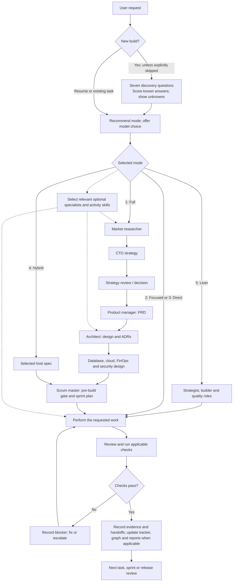

# 🔁 Loop Engineering — Kiro AI Orchestration System

<div align="center">

[](https://github.com/supersaiyane/loopEngineering)


</div>

---

> **Who this README is for:** Someone who has never seen this project before.
> No prior knowledge of Kiro, AI agents, or orchestration systems is assumed.

---

## 📖 Table of Contents

1. [What Is This Project?](#-what-is-this-project)
2. [The Problem It Solves](#-the-problem-it-solves)
3. [How Kiro Works (Background)](#-how-kiro-works-background)
4. [System Architecture](#-system-architecture)
5. [The 5 Execution Modes](#-the-5-execution-modes)
6. [Core and Optional Agent Roles](#-core-and-optional-agent-roles)
7. [Key Concepts Explained](#-key-concepts-explained)
8. [File Structure](#-file-structure)
9. [Steering Files — What Each One Does](#-steering-files--what-each-one-does)
10. [Quality Gates & Guards](#-quality-gates--guards)
11. [⚡ Setup & Usage — Kiro, Claude, ChatGPT](#-setup--usage--kiro-claude-chatgpt)
12. [🗜️ Token Compression — pxpipe](#️-token-compression--pxpipe)
13. [The Fix Register — What Was Built](#-the-fix-register--what-was-built)
14. [Dry Run History](#-dry-run-history)
15. [R&D Research Files](#-rd-research-files)
16. [Roadmap](#-roadmap)
17. [Glossary](#-glossary)

---

## 🤔 What Is This Project?

> **Status:** This is an experimental process framework. Internal dry runs are documented, but independent validation and controlled comparisons are still planned.
> Review the [security guidance](SECURITY.md) and [release checklist](docs/release-checklist.md) before using it for a release or sensitive project.

**Loop Engineering** is a system of rules, files, and protocols that tells the **Kiro AI IDE** how to behave like a structured engineering team — instead of just answering prompts one at a time.

Think of it as **a constitution for an AI development team.** When you type a prompt into Kiro, this system decides:

- What kind of task is this? (bug fix, new feature, quick question?)
- Which AI agents should work on it? (just one? a full team of 22?)
- What quality checks must pass before any code is merged?
- How should agents remember past mistakes?

Without this system, Kiro answers each prompt independently — like a contractor who shows up fresh every day with no memory of yesterday. **With this system**, Kiro behaves like a senior engineering org with sprint planning, code reviews, security gates, and institutional memory.

---

## 🎯 The Problem It Solves

The production reliability crisis in agentic AI systems is real and documented. Frontier models are capable. The process architectures are not. Loop Engineering is the process layer that closes the gap.

| Problem Without This System | How This System Fixes It |
|-----------------------------|--------------------------|
| Kiro re-invents solutions it already wrote | Memory system + lessons.md compounds knowledge across sessions |
| Kiro launches 19 agents for a simple bug fix | Discovery engine scores your request and picks the right-sized team |
| Agents write 200-line custom code when a library already exists | Ponytail guidance asks agents to consider existing options first |
| A security flaw passes code review because coverage % looked fine | GATE S2 asks for explicit cross-tenant isolation tests on applicable stories |
| One AI agent can unilaterally restructure your entire auth system | Bad-loop guidance asks for review of high-risk changes; host permissions provide the actual boundary |
| Team forgets architectural decisions by sprint 3 | ADR (Architecture Decision Records) + steering files persist decisions |
| AI agents guess at which tools/skills to use | The matrix and specialist catalog map activities to relevant skills; actual reads require verification |

---

## ⚙️ How Kiro Works (Background)

> **New to Kiro?** Here's the minimum you need to know.

[Kiro](https://kiro.dev) is an AI-powered IDE. When you write a prompt, Kiro can:
- Read files in your project
- Write and edit code
- Activate specialized AI agents for different tasks
- Load "steering files" that shape how it behaves

The `.kiro/` folder (or `kiro/` in this repo) is where Kiro looks for its configuration. This project fills that folder with a structured orchestration system.

For a new build, the hook asks the assistant to run discovery. After the user
answers all seven questions, the assistant recommends a mode and offers model
selection before design begins. Actual hook execution and model selection depend
on the host; the model picker controls the selected model.

---

## 🏗️ System Architecture



The coordinator selects relevant specialists at the stage their work needs them;
the optional roles do not all run in sequence. In a sprint, the executable
workflow records a reviewed story commit before running its verification
command. The hook and steering files provide guidance; technical checks and
independent agents run only when invoked and permitted by the host. See the
[detailed current flow and historical diagram](docs/Audits/kiro-flow-2026-07-01.txt)
and [execution contract](kiro/steering/execution-contract.md).

---

## 🎭 The 5 Execution Modes

The system picks one of 5 modes based on how complex your request is.

| Mode | Name | When Used | Agents Activated |
|------|------|-----------|-----------------|
| **Mode 1** | 🏰 Full Army | Large platform, enterprise, multi-service | Applicable core and optional roles |
| **Mode 2** | 🎯 Single Role | A focused specialist task or artifact | One relevant role |
| **Mode 3** | ⚡ Direct | Bug fix, trivial task, quick question | 1 role or none |
| **Mode 4** | 🔬 Hybrid | A host spec workflow followed by structured development | Roles matched to scope |
| **Mode 5** | 🌱 Lean | MVP, startup, solo dev, small team | 3 core roles (lite) |

### How the mode is chosen

Discovery is a heuristic: scores 0–4 recommend Mode 3, 5–9 Mode 5, 10–14
Mode 4, and 15–21 Mode 1. Mode 2 handles a focused specialist request. The
user's explicit choice takes precedence. See the [execution contract](kiro/steering/execution-contract.md).

Roles are responsibilities applied by an assistant. They are not independent
agents or reviews unless the host actually runs separate agents. Prompt-based
gates are guidance; their enforcement depends on the host and configuration.

---

## 👥 Core and Optional Agent Roles

Each role has its own `SKILL.md` and a library of specialist skill files.

| # | Role | What They Do |
|---|------|-------------|
| 1 | 🧠 **CTO** | Tech strategy, stack selection, build-vs-buy decisions |
| 2 | 📐 **Architect** | System design, ADRs, threat modeling |
| 3 | 🗄️ **Database Architect** | Schema design, query optimization, migrations |
| 4 | ☁️ **Cloud Architect** | AWS/GCP/Azure infrastructure, VPC, IAM |
| 5 | 💰 **FinOps Architect** | Cloud cost optimization, budget alerts |
| 6 | 🔒 **Security Engineer** | OWASP, CVE scanning, pentesting, compliance |
| 7 | 🎯 **Product Manager** | PRD, user stories, acceptance criteria |
| 8 | 🔄 **Scrum Master** | Sprint planning, gates, retrospectives |
| 9 | 🖥️ **Backend Lead** | API design, microservices, database patterns |
| 10 | 🎨 **Frontend Lead** | Component architecture, design systems |
| 11 | ⚙️ **Senior Engineer BE** | Backend implementation, code quality |
| 12 | 🖌️ **Senior Engineer FE** | Frontend implementation, accessibility |
| 13 | 📱 **Mobile Engineer** | iOS/Android, React Native, App Store rules |
| 14 | 🚀 **DevOps Engineer** | CI/CD pipelines, Docker, Kubernetes |
| 15 | 🛡️ **SRE Engineer** | Reliability, SLOs, incident response |
| 16 | 🤖 **ML Engineer** | Model serving, embeddings, ML pipelines |
| 17 | 📊 **Data Engineer** | Kafka, Spark, dbt, data pipelines |
| 18 | 🔬 **Data Scientist** | A/B testing, cohort analysis, EDA |
| 19 | 🧪 **QA Engineer** | Test strategy, automation, coverage |
| 20 | ✍️ **Technical Writer** | Documentation, runbooks, app flow docs |
| 21 | 📣 **Market Researcher** | Competitor analysis, market positioning |
| 22 | 🌐 **Website Creator** | Landing pages, SEO, web content |

In addition to these 22 core roles, 28 optional specialists cover data, AI,
design, learning, privacy, accessibility and platform work. The coordinator
selects them by task; see the [complete specialist and skill catalog](kiro/steering/optional-specialists.md).

---

## 💡 Key Concepts Explained

### 🪢 The Ponytail Ladder

> **Problem:** AI agents love writing custom code. They'll build a 300-line auth system when `passport.js` already exists. This wastes time and creates maintenance debt.

The Ponytail guidance describes a **7-rung ladder** for considering existing options before custom work. Whether an agent follows it depends on the host and run.

```
Rung 1 → Use the standard library (built-in language features)
Rung 2 → Use an installed dependency (existing package)
Rung 3 → Use a configuration file (environment variable, config)
Rung 4 → Use an existing tool/CLI
Rung 5 → Compose existing services (API calls, wrappers)
Rung 6 → Fork an existing open-source project
Rung 7 → Write custom code from scratch ← LAST RESORT ONLY
```

If a rung is disqualified (e.g., a CVE vulnerability in a package), the guidance calls for a **Rung Disqualification Record (RDR)** and a same-rung alternative check. See the [rung disqualification guide](docs/research/ponytail-rung-disqualification-guide.md).

---

### 🔍 The Discovery Engine

For each new build, the system presents seven structured discovery questions:

```
1. PLATFORM     — Web / Mobile / Desktop / CLI / Library?
2. SCALE        — Just you / Small team / Public product / SaaS?
3. COMPLEXITY   — Simple / Medium / Complex / Enterprise?
4. DEPLOYMENT   — Local / Single server / Cloud managed / Multi-region?
5. REVENUE      — None / Ads / One-time / Subscription / Enterprise?
6. DESIGN & UX  — None / Basic / Polished / Branded?
7. SECURITY     — Minimal / Basic auth / User data / Regulated?
```

Score 0–21 → maps to a mode:

| Score | Tier | Mode |
|-------|------|------|
| 0–4 | Minimal | Mode 3 (Direct) |
| 5–9 | Lean | Mode 5 (Lean) |
| 10–14 | Standard | Mode 4 (Hybrid) |
| 15–18 | Full | Mode 1 (Full Army) |
| 19–21 | Enterprise | Mode 1 (Full Army + extras) |

---

### 🛡️ Bad Loop Guard (GUARD 2)

> **Problem:** AI agents can get excited and propose restructuring your entire database schema mid-sprint. This is dangerous.

The bad loop guard is prompt guidance asking agents to seek review of high-risk scope changes. Actual blocking requires host permissions and verification. Its documented triggers include:

```
Domain keywords:  auth / payments / billing / database / production / security
High-risk verbs:  redesign / restructure / rewrite / replace / refactor / migrate

auth + refactor  →  BLOCKED (requires human confirmation)
deploy           →  BLOCKED (self-triggering, no verb needed)
auth + implement →  ALLOWED (implement is not high-risk)
```

---

### 🧠 The Memory System (5-Stage Progression)

Lessons don't just get written — they must graduate through 5 stages before becoming rules:

```
Stage 1 — FAIL      → Document the failure in detail
Stage 2 — INVESTIGATE → Find the root cause (the WHY, not just the WHAT)
Stage 3 — VERIFY    → Confirm with actual evidence (not a feeling)
Stage 4 — DISTILL   → Write a general rule that applies beyond this case
Stage 5 — CONSULT   → Read this entry BEFORE starting the next related task
```

> A lesson stuck at Stage 1-Fail for more than 1 sprint is a **stale blocker** — the system flags it and can block Sprint N+1 until resolved.

---

### 📋 Comprehension Debt Gate

At the end of every sprint, the Scrum Master runs a 4-question binary check (yes/no only):

```
□ Did every agent read the full diff before approving it?
□ Did VERIFIER produce evidence (test output / logs) — not just "looks good"?
□ Were all architectural constraints re-confirmed at session start?
□ Were any "mostly working" or "looks fine" close conditions present?
```

`0/4` failures = **CRITICAL** → Sprint is blocked. No new stories until debt is cleared.

---

## 📁 File Structure

```
loopEngineering/
│
├── 📄 README.md                    ← You are here
├── 📄 CONTRIBUTING.md              ← Reproduction guide + citation format
├── 📄 LICENSE                      ← MIT License (Fix 45A)
├── 📄 index.html                   ← Showcase website (one-pager)
├── 📄 context_index.md             ← Function-level index of the whole system
├── 📄 project_map.md               ← Module-level map of the whole system
├── 🔗 .kiro → kiro/                ← Symlink: Kiro reads from here
│
├── 📂 kiro/                        ← All orchestration files live here
│   │
│   ├── 📂 hooks/
│   │   └── elite-team-orchestrator.json  ← Entry point (Kiro hook definition)
│   │
│   ├── 📂 steering/                ← The constitution (14 files)
│   │   ├── orchestrator-routing.md      ← Mode routing + phase/event auto-triggers (Fix 47B)
│   │   ├── team-orchestrator-core.md    ← Core execution rules + ADR decisions.md writes (FIX F)
│   │   ├── team-orchestrator-sprint.md  ← Sprint lifecycle + STORY DONE PROTOCOL (FIX B/C/D/E/F)
│   │   ├── team-orchestrator-rules.md   ← NON-NEGOTIABLES + GATE S1/S2
│   │   ├── discovery-engine.md          ← 7-question discovery + scoring
│   │   ├── ponytail.md                  ← 7-rung ladder enforcement
│   │   ├── session-guards.md            ← GUARD 1 + GUARD 2 + GUARD 3 (pxpipe) + GUARD 4
│   │   ├── skill-selection-matrix.md    ← Story label → skill file mapping (119 rows, Fix 47C/D)
│   │   ├── skill-label-index.md         ← role and skill lookup index
│   │   ├── loop-engine.md               ← PLAN→DO→VERIFY→DECIDE loop spec
│   │   ├── context-memory-discipline.md ← Token budgets + degradation tiers
│   │   ├── memory-management.md         ← Cross-session memory protocols
│   │   ├── phase-reporting.md           ← Report templates per phase
│   │   └── team-orchestrator.md         ← Legacy (superseded by split files)
│   │
│   ├── 📂 memory/                  ← Runtime state (live session files)
│   │   ├── checkpoint.md           ← Session continuity (resume from here)
│   │   ├── lessons.md              ← Cross-session learning log (5-stage graduation)
│   │   ├── decisions.md            ← Architectural decisions (ADRs)
│   │   ├── project_map.md          ← Module-level map of the whole system
│   │   └── flow.md                 ← End-to-end system flow reference
│   │
│   ├── 📂 skills/                  ← core, optional and shared specialist guidance
│   │   ├── cto/                    ← CTO skill library (10 files)
│   │   ├── architect/              ← Architect skills + product_graph_update.md (Fix 46A)
│   │   ├── security_engineer/      ← Security skills (24 files)
│   │   ├── backend_lead/           ← Backend skills (14 files)
│   │   ├── ... (18 more roles)
│   │   └── shared/                 ← Cross-role shared skills + graph_patch_emit.md (Fix 46A)
│   │
│   └── 📂 adapters/                ← Platform adapter files
│       ├── claude-system-prompt.md      ← Paste into Claude Project Instructions
│       ├── claude-setup-guide.md        ← Detailed Claude setup walkthrough
│       ├── chatgpt-system-prompt.md     ← Paste into ChatGPT Instructions
│       └── chatgpt-setup-guide.md       ← Detailed ChatGPT setup walkthrough
│
├── 📂 scripts/                     ← Utility scripts
│   ├── bootstrap-project.sh        ← One-command new project scaffolder (FIX A: git init)
│   └── start-kiro-pxpipe.sh        ← Launch Kiro through pxpipe proxy
│
├── 📂 healthguard-pro/             ← Live demo project (MedVault Sprint 1 — FIX A–G validated)
│   ├── services/                   ← Go microservices (auth, patient, billing, alerting, ML)
│   ├── apps/                       ← Frontend apps (clinician dashboard, patient mobile)
│   ├── infra/terraform/            ← IaC: us-east-1 + eu-west-1 modules
│   ├── docs/                       ← PRD, TRD, 5 ADRs, sprint-1/, schemas, graph/
│   └── kiro/memory/                ← Project-specific checkpoint + lessons
│
└── 📂 docs/                        ← Evidence, decisions, research artifacts
    ├── graph/product-graph.yaml    ← Living product knowledge graph
    ├── graph/product-graph.html    ← Standalone generated graph
    ├── CLAUDE-working.md           ← Active fix register (68 fixes)
    ├── CLAUDE-implemented.md       ← Full implementation history: Fix 1–FIX G
    ├── Audits/                     ← 12 dry run files + system review audits
    │   └── external-validator-outreach.md  ← R1: HN/Reddit/LinkedIn/Discord posts
    ├── white-paper/
    │   ├── loop-engineering-white-paper-v5.docx
    │   └── loop-engineering-white-paper-v5.pdf  ← 34pp publication draft
    └── research/                   ← R&D research files
        ├── GOAT.md                          ← Honest gap + strength inventory
        ├── competitor-comparison.md          ← Fix 45C: MemGPT, LangMem, Devin
        ├── compression-fidelity-methodology.md  ← Fix 45B: exact test methodology
        ├── gstack-research.md               ← gstack vs Loop Engineering analysis
        ├── oneagent-search.md               ← 67TB logs/metrics/traces architecture
        └── ponytail-rung-disqualification-guide.md  ← Dep disqualification protocol
```

---

## 📜 Steering Files — What Each One Does

| File | Inclusion | Purpose |
|------|-----------|---------|
| `orchestrator-routing.md` | On demand | Mode detection + routing logic (Modes 1–5) |
| `team-orchestrator-core.md` | On demand | Core execution rules, role handoffs, NON-NEGOTIABLES |
| `team-orchestrator-sprint.md` | On demand | Sprint lifecycle: SM-PLAN → DEVELOP → SM-GATE → SM-RETRO |
| `team-orchestrator-rules.md` | On demand | GATE S1 (security) + GATE S2 (PR review) checklists |
| `discovery-engine.md` | On demand | 7 discovery questions → score → mode recommendation |
| `ponytail.md` | **Always** | 7-rung ladder — loaded before any agent fires |
| `session-guards.md` | **Always** | GUARD 1 (constraint drift) + GUARD 2 (bad loop) + GUARD 3 (pxpipe image context) |
| `skill-selection-matrix.md` | On demand | Maps story labels → exact skill files to load |
| `skill-label-index.md` | On demand | Filename index for specialist skills |
| `loop-engine.md` | On demand | PLAN→DO→VERIFY→DECIDE loop specification |
| `context-memory-discipline.md` | On demand | Token budgets, degradation tiers (PEAK→CRITICAL) |
| `memory-management.md` | On demand | How to write, promote, and expire lessons |
| `phase-reporting.md` | On demand | Report format templates for each sprint phase |

> Loading behavior depends on the host and configuration; verify which guidance is actually included.

---

## 🚪 Quality Gates & Guards

### GATE S1 — Security Pre-Check (before DEVELOP)

Runs **before** development starts. Blocks stories with security implications until reviewed.

```
□ OWASP Top 10 threat model completed
□ IAM/auth scope estimated (IAM stories routinely run 1.5–2× estimate — warned here)
□ CVE scan on new dependencies → if CVE found, RDR required + same-rung alt check
□ Secrets/credentials not hardcoded
□ Compliance scope confirmed (GDPR, PCI-DSS, SOC2, HIPAA as applicable)
```

### GATE S2 — PR Review (before merge)

Runs **before** any code merges to main.

```
□ SAST scan clean (e.g., gosec, semgrep)
□ OWASP A01 (Broken Access Control) + A07 (Identification Failures) checked
□ Secrets scan clean (e.g., gitleaks)
□ New dependencies reviewed (Ponytail rung documented)
□ PONYTAIL CHECK: lowest qualifying rung used? RDR if disqualified?
   └─ If story tagged security/rbac OR data/multi-tenant:
      → At least 1 explicit cross-tenant access-DENIAL test REQUIRED
      → Absence = GATE S2 FAIL regardless of coverage %
□ Jira comment written with: SAST / OWASP / Secrets / Deps / Ponytail verdict
```

### GUARD 1 — Constraint Drift

Re-reads all binding constraints at **every session start**. Prevents the model from forgetting "we don't use Redis" by turn 47.

### GUARD 2 — Bad Loop Detection

Blocks agents from self-escalating scope without human approval. Fires on high-risk domain + verb combinations. See [Key Concepts](#-key-concepts-explained) above.

### GUARD 3 — pxpipe Image Context (Fix 44G)

When the pxpipe token-compression proxy is active, old history turns are stored as PNG images. The model reads them at gist-level accuracy (decisions, paths, values = **98/98 lossless**) but NOT at byte-exact level — ~13% silent misread rate on exact strings.

GUARD 3 tells every agent: never recall exact strings from image context — always re-fetch from the canonical source.

```
BLOCKED from image recall:  git SHAs · file:line refs · camelCase identifiers
                             exact error codes · checkpoint timestamps

SAFE from image recall:     decisions made · file names · architecture intent
                             status summaries · counts and relative values
```

See [Token Compression — pxpipe](#️-token-compression--pxpipe) for full setup.

### GUARD 4 — Pre-Code Artifact Gate (GAP-48B)

Blocks code writes until process artifacts exist. Fires before any file is written to `services/`, `apps/`, `infra/`, or `packages/`.

```
□ docs/prd.md (or .kiro/specs/requirements.md) exists?
□ docs/sprint-N/sprint-plan.md exists?
□ docs/sprint-N/stories/<STORY-ID>.md exists?

ALL present → [GUARD-4: PRE-CODE-GATE PASS] → code may proceed
ANY missing → [GUARD-4: BLOCKED] → create the missing artifact first
```

User may say "skip docs" to override — logged as process debt.

---

## ⚡ Setup & Usage — Kiro, Claude, ChatGPT

This system runs on **three platforms**. Pick the one you use.

---

### 🟣 PLATFORM 1 — Kiro IDE (Native)

> **This is the primary platform.** The `.kiro/` folder and hook were built specifically for Kiro.

#### How the Kiro integration works — Phase Split model

Loop Engineering uses a **three-phase model** (THINK → DESIGN → DEVELOP) that works with Kiro's native behavior, not against it:

| Phase | Owner | What happens |
|-------|-------|-------------|
| **THINK phase** | User and assistant | Ask all seven discovery questions, score the answers, recommend a mode, and offer model selection |
| **DESIGN phase** | User-selected workflow | Use an existing/native spec or Loop Engineering design artifacts |
| **DEVELOP phase** | Loop Engineering | Say "start sprint 1" → hook activates: GUARD 4, sprint planning, story cards, role contracts, gates, SM-RETRO |

The prompt hook provides process guidance. Its behavior depends on the Kiro version and must be verified in the host.

#### Step 1 — Bootstrap a new project (recommended)

Use Bash, Git, Python 3.11 or newer, and a filesystem that supports symlinks.
Kiro integration must be verified in your installed host. To run the migration
integration tests, install the pinned test dependencies described below.

Use the included script to create a new project snapshot:

```bash
cd ~/MyTechExploration/loopEngineering
./scripts/bootstrap-project.sh MyProjectName ~/Projects
```

This creates `~/Projects/MyProjectName/` with everything pre-wired:
- `.kiro/hooks/` — `elite-team-orchestrator.json` (Kiro-native THREE-PHASE hook)
- `.kiro/steering/` — steering files
- `.kiro/skills/` — skill guidance across the roles
- `.kiro/memory/` — fresh checkpoint.md, decisions.md, lessons.md, flow.md, project_map.md
- `kiro → .kiro` symlink created automatically
- `git init` runs automatically; review and commit the files yourself
- `trigger-prompt.md` — fill-in template ready to paste into Kiro

Project names must start with a letter or number and contain only letters,
numbers, dots, underscores, and hyphens. The bootstrap refuses to overwrite
an existing path.

#### Sprint tracking and commit checks

For sprint work, the default is real Jira Cloud issues. After selecting an
existing Jira project and preparing story cards, configure `JIRA_BASE_URL`,
`JIRA_EMAIL` and `JIRA_API_TOKEN` securely in your environment, then run:

```bash
python3 scripts/sprint_gate.py init-jira 1 --project PROJECT --issue-type Story
python3 scripts/sprint_gate.py check-start 1 --mode jira
# After reviewing changes and testing the story, commit only the listed files:
python3 scripts/sprint_gate.py commit-story 1 S1-01 --message 'feat: implement S1-01' path/to/reviewed-file
# Run a meaningful verification command against the committed story:
python3 scripts/sprint_gate.py run-check 1 S1-01 -- python3 -m unittest discover -s tests
# After the issue is transitioned to Done in Jira:
python3 scripts/sprint_gate.py check-story 1 S1-01 --mode jira
# Before closing the sprint:
python3 scripts/sprint_gate.py check-sprint 1 --mode jira
# Generate sprint agent and Git/tracker summaries:
python3 scripts/sprint_report.py 1
```

Replace the project key and story ID with your own. `init-jira` sends story-card
content to that Jira project; it does not create the project itself. An uncertain
creation leaves a pending receipt and requires reconciliation to avoid duplicate
issues. Custom required Jira fields or missing permissions may block creation.
When Jira is unavailable, use `init-local` and `--mode local`; those records
are not Jira issues. `update-local` records status changes; `export-local` can
produce an internal JSON archive or Jira-oriented CSV and JSON exports. The
Jira exports include local history as description text. They require field
mapping and live import validation; native Jira history, duplicate handling on
manual import, and automated synchronization are not yet supported. See the
[tracking contract](kiro/steering/sprint-tracking-contract.md).

For example, to retain local history and prepare a Jira-oriented JSON file:

```bash
python3 scripts/sprint_gate.py init-local 1
python3 scripts/sprint_gate.py update-local 1 S1-01 --status 'In Progress' --note 'Implementation started'
python3 scripts/sprint_gate.py export-local 1 --format jira-json --project PROJECT --output docs/jira-import.json
```

The checker verifies reachable story-linked commits and tracker records, but it
cannot force Kiro to invoke it or independently prove tests passed. The commit
helper refuses pre-existing staged changes and accepts existing files only;
review and commit deletions separately.

The reports summarize local records and do not prove an independent agent ran,
that tests were sufficient, or that a Jira issue is still accessible. They
refuse to replace files that were not generated by the report tool.

`python3 scripts/project_index.py` generates a foundation index and a project
work summary from existing story cards and local tracker records. The index
shows registration order when documents are recorded immediately after creation
with `python3 scripts/project_index.py --record FILENAME.md`; it does not
reconstruct earlier creation history. It
marks missing role and duration information as unknown and refuses to replace
user-authored files.

For an explicit local vulnerability check with Trivy installed:

```bash
python3 scripts/security_scan.py --manifest requirements.txt --image my-image:tag 1
```

Repeat the manifest and image flags for each target. The command blocks on
findings or declared targets the scanner does not report, and writes Markdown
and JSON records under `docs/reports/`. Use `--no-images` only when the project has
none. `--compose compose.yaml` can resolve images from the active Compose
configuration. Add `--secrets` for a redacted working-tree secret scan; it
does not scan Git history. Generated `make security-scan` includes that scan.
The scanner database must have been updated recently. Common
dependency manifests are discovered and any missing from the declared list
block the scan. A `--no-images` declaration also blocks if common Dockerfile
names are found; an image result with no scanner targets is treated as unknown.
Discovery excludes symlinks and dependency caches and is not
exhaustive. Image inventory completeness (including inactive profiles), actual image digests,
Git-history secret scans and CI artifact retention require separate checks; this helper does
not remediate vulnerabilities or prove unknown vulnerabilities are absent.
`python3 scripts/delivery_setup.py --manifest requirements.txt --compose compose.yaml --sprint 1`
can create an opt-in Makefile and GitHub security workflow for a new project.
Pass `--lint-command '...'` and `--test-command '...'` (and optionally
`--setup-command`, `--db-verify-command` and `--docs-refresh-command`) using
the project's real commands. They are parsed into argument arrays and run
without a shell; configure pipelines in a project-owned script. Missing commands
block their targets. `make preflight` runs lint, tests, the declared Compose
build if applicable, and the security scan; the generated workflow currently
runs security only, so it is not a complete CI equivalent. Configure and verify
the remaining CI jobs for the chosen stack.
`python3 scripts/migration_setup.py` can initialize an Alembic revision chain
for a Python project; reviewed schema migrations must still be authored and tested.
`python3 scripts/design_audit.py --schema PATH` checks for required system-design
sections, diagrams and declared schema files; it cannot verify their accuracy.

The bootstrap also creates Kiro-compatible `loop-*` agent profiles and skill
wrappers while preserving original role files. Choose `loop-coordinator` in a
Kiro version that supports these profiles; actual subagent availability and
permissions must be verified in that host.

The framework includes 28 optional data, AI, product design, privacy and
platform specialists in addition to its core roles. Their task triggers and
focused skills are listed in the [optional specialist catalog](kiro/steering/optional-specialists.md).
They are available in new bootstrapped projects, but should be selected only
for relevant work or an explicit request; a profile is not evidence that an
independent agent ran. The generator refuses conflicting existing profiles or
wrappers instead of overwriting customizations. Existing projects have their own
snapshots and need a reviewed, project-specific update before these additions
appear; reload Kiro and verify discovery in the actual host. Do not assume a
prompt or skill guarantees a particular action or access to a tool.

To add a future specialist globally, create its `kiro/skills/<role>/SKILL.md`
and focused activity files, add it to `optional_roles` in
`kiro/framework-contract.json`, and add task triggers and role-qualified paths
to the specialist catalog. Run `python3 scripts/prepare_kiro_agents.py --root .`
and `python3 scripts/validate-framework.py`, then exercise a fresh disposable
bootstrap and Kiro discovery. `required_roles` is for the core catalog; adding
an optional role makes its profile available without requiring it on each task.
The generator fails on conflicting custom files—review them rather than
deleting or overwriting them automatically.

#### Updating an existing snapshot

The upgrade tool needs the **exact framework checkout used to create the
existing snapshot** as its baseline. If that baseline is unknown or a file was
customized, stop and reconcile it manually; do not guess or replace it. Close or
pause sessions that may write to the project during an upgrade. Preview first:

```bash
python3 scripts/framework_upgrade.py --source . --baseline /path/to/old-framework --target /path/to/project
python3 scripts/framework_upgrade.py --source . --baseline /path/to/old-framework --target /path/to/project --apply --backup-dir /path/outside/project/new-backup
python3 scripts/validate-framework.py --root /path/to/project
```

The backup directory must not already exist. The tool checks all managed paths
before applying, retains files removed upstream, and leaves project documents,
memory, reference documents and unknown files alone. If updated guidance refers
to new reference documents, review and reconcile those separately before use.
To roll back, run:

```bash
python3 scripts/framework_upgrade.py --target /path/to/project --restore /path/outside/project/new-backup
```

Rollback refuses to overwrite files edited after the upgrade. Keep the backup
until the project is verified. A crash or concurrent edit can interrupt an
operation; inspect the backup manifest and project before retrying. This tool
does not restart existing agent sessions or prove they reloaded instructions.

#### Specialist handoffs

For a multi-discipline sprint, create a plan such as `team-plan.json`:

```json
{"tasks": [
  {"id": "design", "role": "architect", "depends_on": [], "outputs": ["docs/design.md"],
   "required_skills": [".kiro/skills/architect/SKILL.md"]},
  {"id": "qa", "role": "qa_engineer", "depends_on": ["design"],
   "outputs": ["docs/sprint-1/evidence/S1-01.json"],
   "verification": "docs/sprint-1/evidence/S1-01.json",
   "required_skills": [".kiro/skills/qa_engineer/SKILL.md"]}
]}
```

Run `python3 scripts/team_flow.py init team-plan.json`, then start and complete
each task with its assigned role, for example `python3 scripts/team_flow.py
start design --role architect` and `python3 scripts/team_flow.py complete
design --role architect --summary 'Design ready for QA' --skill .kiro/skills/architect/SKILL.md`.
List each required role and activity skill under `required_skills` and repeat
`--skill` for the completion claim. This checks file hashes, not that the host
actually read them. The next task receives
the checked paths and hashes of upstream outputs. QA evidence can be generated
by the `sprint_gate.py run-check` command above. The ledger records local
coordination; it neither launches nor authenticates agents and cannot prove
that a command is a sufficient test. Use Kiro's actual subagent facility and
inspect its results to verify independent execution.
The ledger holds one active plan per project; preserve and archive the existing
`.loop/team-flow.json` before initializing a new plan. A stale
`.loop/team-flow.lock` after an interrupted process must be checked and removed
only after confirming no other team-flow process is running.

#### Step 2 — Or set up manually (existing project)

```bash
git clone https://github.com/supersaiyane/loopEngineering.git
cd loopEngineering
ln -s kiro .kiro    # Kiro reads .kiro/, this repo uses kiro/
```

Verify:
```bash
ls .kiro/hooks/       # → elite-team-orchestrator.json
ls .kiro/steering/    # → 14 steering files
ls .kiro/memory/      # → checkpoint.md, lessons.md, decisions.md, flow.md, project_map.md
```

#### Step 3 — Open in Kiro and run the spec phase

Open your project in Kiro and describe the new build. Answer all seven discovery questions, review the recommended mode, and choose a model. Then proceed with the selected design workflow. For the CLI, use `kiro-cli chat --list-models --format json` to inspect available models and `/model` to select one. In the IDE, use its model picker. See [model selection](kiro/steering/model-selection.md).

```
i want to build "MedVault — Multi-tenant pharmacy adherence platform"
HIPAA + PCI-DSS · AI refill predictions · iOS/Android · Multi-region AWS
```

#### Step 4 — Activate the develop pipeline

Once specs are ready, trigger Loop Engineering:

```
start sprint 1
```

The hook activates and runs:
1. Reads `checkpoint.md` + `lessons.md` + `decisions.md`
2. For a full sprint, check the PRD/spec, sprint plan and story card; prompt-based checks depend on the host
3. Loads `team-orchestrator-core.md` + role contract table
4. SM-PLAN → story cards → role-based implementation → GATE 5 → SM-RETRO

#### 🚨 Troubleshooting

| Symptom | Fix |
|---------|-----|
| Hook not loading at all | Verify symlink: `ls -la .kiro` must show `→ kiro` |
| Steering files not found | Both `kiro/steering/` and `.kiro/steering/` work via symlink |
| GUARD 4 blocking code writes | Correct behaviour — create the missing artifact it lists first |
| Hook silent when you want it to activate | Say explicitly: "start sprint 1" or "begin development" |

---

### 🔵 PLATFORM 2 — Claude (claude.ai Projects)

> Best for: ongoing builds without Kiro, or using Claude as the AI engine alongside the system.

#### Step 1 — Create a Claude Project

1. Go to **[claude.ai](https://claude.ai)** → left sidebar → **"New Project"**
2. Name it: `Loop Engineering` or your product name
3. Click **Create Project**

#### Step 2 — Paste the system prompt

1. Inside the project → **"Project Instructions"** (gear icon or top right)
2. Open `kiro/adapters/claude-system-prompt.md` in any text editor
3. Copy everything **below** the `# ─────` comment line
4. Paste into Project Instructions → **Save**

#### Step 3 — Upload Knowledge files

Click **"Add Content" → "Upload files"** and upload these from `kiro/steering/`:

| File | Purpose |
|------|---------|
| `team-orchestrator-core.md` | Core execution rules + role handoffs |
| `team-orchestrator-rules.md` | NON-NEGOTIABLES + GATE S1 + GATE S2 |
| `team-orchestrator-sprint.md` | Sprint lifecycle + SM-RETRO |
| `skill-selection-matrix.md` | Story label → skill file mapping |
| `loop-engine.md` | PLAN→DO→VERIFY→DECIDE loop |
| `discovery-engine.md` | 7 scoping questions + scoring |
| `ponytail.md` | 7-rung lazy load ladder |
| `session-guards.md` | GUARD 1 + GUARD 2 |

**Optional (recommended for existing projects):**
- `kiro/memory/lessons.md` — past lessons (HIGH-confidence rules apply immediately)
- `kiro/memory/decisions.md` — ADR constraints (bind all roles)

#### Step 4 — Start your first session

Open a new conversation in the project and type:
```
[NEW SESSION]
Product: <what you're building>
Phase: THINK (or DESIGN / DEVELOP if resuming)
Last action: <what was done last, or "starting fresh">
```

#### Step 5 — Resuming a build

Paste your latest checkpoint entry at the start of each new conversation:
```
Resuming from checkpoint:
Sprint 2 / Phase 1. Last: backend auth complete. Next: FE integration story AUTH-003.
Files: docs/phase-1/sprint-plan.md (Sprint 2 section)
```

Claude Projects remember Knowledge files but not conversation history — the checkpoint paste is your resume mechanism.

#### Mode shortcuts (same as Kiro)
```
mode 1: build me a [platform]
mode 2: write the PRD for [feature]
mode 5: lean mode — small team
run discovery questions
```

---

### 🟢 PLATFORM 3 — ChatGPT (Custom GPT or Project)

> Best for: teams who prefer GPT-4o, or for sharing the system with others via a Custom GPT link.

#### Option A — Custom GPT (shareable, persistent) — Recommended

**Requires:** ChatGPT Plus, Team, or Enterprise.

1. Go to **[chat.openai.com](https://chat.openai.com)** → **"Explore GPTs"** → **"Create"**
2. Click the **"Configure"** tab
3. Set **Name:** `Loop Engineering Elite Team`
4. Set **Description:** `Experimental engineering orchestration guidance with task-selected specialists and review gates`
5. In the **Instructions** field: open `kiro/adapters/chatgpt-system-prompt.md`, copy everything below the `# ─────` line, paste it in
6. **Knowledge → Upload files:** same 8 steering files as Claude setup above
7. **Capabilities:** enable ✅ Web Search + ✅ Code Interpreter
8. **Conversation starters** (paste these in):
   ```
   [NEW SESSION] Product: [name] | Starting: THINK phase
   mode 1: build me a [describe your app]
   mode 5: lean mode — 2-person team, build [describe]
   run discovery questions
   ```
9. Click **Save** → **"Anyone with a link"** (for sharing) or **"Only me"**

#### Option B — ChatGPT Project (personal, no sharing)

1. Left sidebar → **"New Project"** → name it `Loop Engineering`
2. Inside project → **"Customize ChatGPT"**
3. Paste the `chatgpt-system-prompt.md` content into Instructions
4. **Add files** → same 8 steering files

#### Verify setup works

Start with:
```
[NEW SESSION] Product: test | Starting: THINK phase
```
You should see:
```
[ENV] TRACKER_MODE=markdown | GIT_MODE=LOCAL
```

#### Important: ChatGPT pair-programming model

ChatGPT produces commands — **you run them in your terminal.** When the system outputs:
```bash
git checkout -b feature/AUTH-001-user-login
```
Copy that and run it yourself. Think of ChatGPT as the brain, your terminal as the hands.

#### Model recommendations

| Task | Recommended model |
|------|--------------------|
| Full Mode 1 build (all phases) | GPT-4o |
| Architecture + ADR reasoning | o3 or o1 |
| Code generation (senior_engineer roles) | GPT-4o |
| Market research + THINK phase | GPT-4o with web search |
| Mode 3 quick fixes | GPT-4o mini (cost-efficient) |
| Mode 5 lean / fast builds | GPT-4o mini |

---

### 📊 Platform Comparison

| | Kiro IDE | Claude Projects | ChatGPT Custom GPT |
|---|---|---|---|
| Hook auto-loads | ✅ (every prompt) | ✅ (Project Instructions) | ✅ (Instructions field) |
| Steering files auto-loaded | ✅ (symlink) | ✅ (Knowledge upload) | ✅ (Knowledge upload) |
| Runs code directly | ✅ | ❌ (describes code) | ✅ (Code Interpreter) |
| File system access | ✅ | ❌ | ❌ |
| Shareable with team | ✅ (git repo) | ❌ (personal project) | ✅ (GPT link) |
| Best for | Primary dev work | Long-form builds | Teams / GPT preference |
| Setup time | ~5 min | ~10 min | ~15 min |
| Adapter file needed | ❌ (hook handles it) | ✅ `claude-system-prompt.md` | ✅ `chatgpt-system-prompt.md` |

---

### 📁 Adapter Files Location

All adapter files are in `kiro/adapters/`:

```
kiro/adapters/
├── claude-system-prompt.md    ← Paste into Claude Project Instructions
├── claude-setup-guide.md      ← Detailed Claude setup walkthrough
├── chatgpt-system-prompt.md   ← Paste into ChatGPT Instructions
└── chatgpt-setup-guide.md     ← Detailed ChatGPT setup walkthrough
```

> Adapter behavior should be checked against the execution contract and the current host.

---

## Local framework checks

Create a Python environment and install the pinned test dependencies once (the
install requires package access). The checks themselves run locally:

```bash
python3 -m venv .venv
. .venv/bin/activate
python3 -m pip install -r requirements-test.txt
python3 scripts/validate-framework.py
python3 -m unittest discover -s tests -v
```

These checks validate a defined set of files, routing mappings, hook configuration,
and bootstrap behavior. They do not prove a Kiro session loads a hook or that a
model follows it; verify the discovery and model-selection flow in both hosts.
See the [evaluation protocol](docs/research/evaluation-protocol.md) for the
proposed broader measurements.

---

## 🗜️ Token Compression — pxpipe

> **What it is:** An optional third-party proxy intended to compress selected context. Its behavior, compatibility, privacy implications and cost depend on the installed version and provider. Review them before use; Loop Engineering does not require the proxy.

**Historical observations:** earlier notes reported 98/98 gist and 13/15 verbatim recall on a limited sample. These numbers do not establish accuracy, safety or savings for another workload. Measure actual provider usage and independently validate exact strings.

**Why this matters for Loop Engineering specifically:**
Context loading and billing depend on host configuration. No per-prompt savings are established for the current integration.

### Quick Start (30 seconds)

**Step 1 — Install once:**
```bash
npm install -g pxpipe-proxy
```

Review the package and select a version appropriate for your environment before
installing. The launcher runs the installed `pxpipe-proxy` binary; it does not
download a package automatically. The repository does not pin a package version.

**Step 2 — Launch every session:**
```bash
cd loopEngineering
./scripts/start-kiro-pxpipe.sh
```

The script starts the proxy in the foreground. Open Kiro or Claude separately using the environment variable shown in the terminal. Dashboard at `http://127.0.0.1:47821` — shows live token savings per request with a kill switch.

**Step 3 — Validate (first sprint only):**
Check `~/.pxpipe/events.jsonl` after one sprint to see your actual compression ratio.

### What Gets Compressed

| Content | Compressed? | Why |
|---|---|---|
| System prompt + tool docs | ✅ Yes | Static slab — biggest single saving |
| Old history turns (beyond live tail) | ✅ Yes | Dense code/JSON — ~3x compression |
| Recent turns (active working window) | ❌ No | Stays text — agents need byte-exact access |
| Sparse prose | ❌ No | Profitability gate: images only win on dense content |
| git log / SHA output | ❌ No | GUARD 3 keepSharp — exact string protection |

### GUARD 3 Integration

GUARD 3 (in `session-guards.md`) makes agents aware of image context. When pxpipe is active, any exact-string lookup — git SHA, file:line, camelCase identifier — must come from a fresh tool call, not from memory. This aligns with our existing re-read-before-edit protocol.

### Research & Benchmarks

Historical notes and limitations are in the [compression-fidelity methodology](docs/research/compression-fidelity-methodology.md). The previously referenced pxpipe report is not in this repository. Reported results are workload-specific claims, not independently verified savings for a new project. Topics include:
- Benchmark table (gist recall 98/98, verbatim recall 13/15, SWE-bench 10/10 at -65% cost)
- Why our workload is ideal (dense code/JSON, re-reads before edits)
- Comparison with `/compact` (pxpipe keeps content as images vs. `/compact` discards it as prose)
- keepSharp configuration for protecting exact strings

---

## 🔧 The Fix Register — What Was Built

This system was built across **68 fix cycles** (FIX A–G from live MedVault Sprint 1 testing) over multiple sessions. **Phase 1 is complete as of 2026-07-19.**

 

### By Type

| Type | Count | Description |
|------|-------|-------------|
| 🚀 **Feature** | 27 | New capabilities added to the system |
| 🔧 **Fix** | 20 | Bugs and gaps patched |
| 🛡️ **Guard** | 7 | Runtime protection mechanisms |
| 🚪 **Gate** | 8 | Quality enforcement checkpoints |
| 🏗️ **Architecture** | 5 | Structural changes to how files are organized |
| 📊 **Audit/Coverage** | 4 | Fix 47A-D skill activation coverage sweep |

### Key Milestones

| Fixes | What Was Accomplished |
|-------|-----------------------|
| Fix 1–10 | Foundation: tracker abstraction, role splits, skill pipeline, loop engine |
| Fix 11–15 | Precision: routing conflicts, hook rewrite as thin router, cleanup |
| Fix 16–25 | Intelligence: dynamic skill selection, dry run gaps, 22-role library |
| Fix 26–32 | Calibration: confidence scoring, memory system, doc knowledge architecture |
| Fix 33–38 | Enforcement: ponytail ladder, confidence signals, mobile routing |
| Fix 39–42 | Protection: memory progression, comprehension debt, bad loop scoping |
| Fix 43 | Verification: lesson age clock, dep disqualification, cross-tenant gate |
| Fix 44G | ✅ Infra: pxpipe integration — GUARD 3, launch script, CLAUDE.md note |
| Fix 44A | ✅ Mode 5 advisory for security/rbac stories |
| Fix 45A | ✅ Open-source artifacts: LICENSE (MIT) + CONTRIBUTING.md |
| Fix 45B | ✅ Compression-fidelity methodology doc (docs/research/) |
| Fix 45C | ✅ Competitor comparison: MemGPT, LangMem, Cognition Devin |
| Fix 46A | ✅ Product Knowledge Graph: graph_patch_emit, product_graph_update, D3 viz |
| Fix 47A–D | ✅ Skill Activation Audit: 37→119 label rows, phase auto-triggers, universal defaults |
| R1 | ✅ External Validator Outreach: HN + Reddit + LinkedIn + Discord posts drafted |
| GAP-48A | ✅ Lesson graduation triggers — SM-RETRO now auto-promotes Stage 1 → Stage 2 lessons |
| GAP-48B | ✅ GUARD 4 pre-code artifact gate — blocks code before PRD + sprint plan + story card exist |
| GAP-48C | ✅ GATE 5 mandatory HTML knowledge graph — D3 viz auto-emitted, GATE 5 blocks if missing |
| GAP-48D | Role contract guidance defines preconditions and postconditions; host compliance must be checked |
| Hook v4 | ✅ Kiro-native THREE-PHASE MODEL — THINK→DESIGN→DEVELOP, no injection-guard conflicts |
| bootstrap | ✅ `scripts/bootstrap-project.sh` — one-command new project scaffolder with path fix |
| FIX A | Bootstrap initializes Git; the user reviews and creates any initial commit |
| FIX B | ✅ Story Commits Mandatory: git commit after every qa_engineer GATE3 PASS |
| FIX C | ✅ Jira Two-Mode TRACKER_MODE: MCP detection at SM-PLAN, .txt fallback if unavailable |
| FIX D | Story-level YAML graph patches; one cumulative HTML graph per project |
| FIX E | ✅ Sprint Discipline Reports: SM-RETRO generates discipline.md + cumulative dashboard |
| FIX F | ✅ Memory Writes Wired CRITICAL: checkpoint/flow/decisions/project_map at every trigger |
| FIX G | ✅ market_researcher Date-Stamping: dynamic shell date, all data tagged, training data flagged |

> **Phase 1 complete.** Full history: [`docs/CLAUDE-implemented.md`](docs/CLAUDE-implemented.md) · Active register: [`docs/CLAUDE-working.md`](docs/CLAUDE-working.md)

---

## 🧪 Dry Run History

All pipeline verification runs are documented in `docs/`. Each dry run tests the full system against realistic scenarios.

| Version | Date | Scenario | Confidence | Key Finding |
|---------|------|----------|------------|-------------|
| v1 | 2026-06-30 | JWT Auth | Baseline | Hook STEP 6 conflict |
| v2 | 2026-06-30 | Fraud Platform | Improving | Mode false positives |
| v3 | 2026-07-01 | Healthcare / FinTech / B2B / IoT | 7 gaps | 7 gaps → Fix 30 |
| v4 | 2026-07-01 | Data lake / EdTech / Marketplace / IoT | 8 gaps | 8 gaps → Fix 31 |
| v5 | 2026-07-03 | HealthTech / Multiplayer / Enterprise IAM | 6.5/10 | Full wiring trace |
| v6 | 2026-07-09 | Kundli app / Enterprise SaaS / Bugfix / Ponytail | 7.0/10 | Ponytail enforcement |
| v7 | 2026-07-09 | Fix 38 + 33 verification | 7.5/10 | Signal list + mobile routing |
| v8 | 2026-07-10 | Fix 40A–E full audit | 8.5/10 | Memory + guard system |
| v9 | 2026-07-10 | 4 adversarial stress tests | 8.5/10 | Full system coverage |
| v10 | 2026-07-10 | Fintech Fraud SaaS — full pipeline | 9.0/10 | 3 gaps → Fix 43 |
| **v11** | **2026-07-10** | **MEDIUM confidence / Mode 5 / Fix 43 verify** | **9.5/10** | **Gap 44A (LOW)** |

---

## 🔬 R&D Research Files

Three research documents park findings from experiments and third-party tool analysis. These are reference material — not active system files.

| File | What It Contains |
|------|-----------------|
| [`docs/white-paper/loop-engineering-white-paper-v5.pdf`](docs/white-paper/loop-engineering-white-paper-v5.pdf) | **Publication draft white paper (34 pages).** Problem-first framing: the 2026 production reliability crisis → why existing approaches fail → the Loop Engineering Framework as the response. Includes 12-pattern failure taxonomy, gist/exact-string recall bifurcation finding, compression data, guard effectiveness analysis. |
| [`docs/research/GOAT.md`](docs/research/GOAT.md) | **Honest gap analysis.** Where this framework is genuinely first in field (failure mode taxonomy, degradation tiers, compression-fidelity bifurcation, session continuity architecture) vs. what is missing for full academic validation (external reproducibility, controlled methodology, competitor comparison). |
| [`docs/research/compression-fidelity-methodology.md`](docs/research/compression-fidelity-methodology.md) | Historical methodology for investigating compression fidelity; not a current performance guarantee |
| [`docs/research/gstack-research.md`](docs/research/gstack-research.md) | gstack vs Loop Engineering: 30+ slash command inventory, 5 additive capabilities, architectural conflict analysis, decision log (Debugging Iron Law, Edit Scope Lock, QA Executor concept) |
| [`docs/research/oneagent-search.md`](docs/research/oneagent-search.md) | 67TB logs/metrics/traces search: AI agent as query layer on ClickHouse + VictoriaMetrics + Tempo, MCP server spec, cross-signal correlation architecture |

---

## 🔁 How to Reproduce

The core claim: a process layer structurally independent of model capability reduces production failure rates in agentic AI. Here is how to test that yourself.

**1. Clone:**
```bash
git clone https://github.com/supersaiyane/loopEngineering.git
cd loopEngineering
```

**2. Activate (Kiro IDE):**
```bash
ln -s kiro .kiro
# Open Kiro — hook auto-loads on first prompt
```

**Claude Projects:** Paste `kiro/adapters/claude-system-prompt.md` as system prompt + attach 8 knowledge files (see `kiro/adapters/claude-setup-guide.md`).

**3. Run on a real project for ≥5 sessions.** The 12 failure modes (F01–F12) surface within the first 3–5 sessions.

**4. Record observations** — which failure modes appeared, at what frequency, before and after the framework. Open a GitHub Issue with your findings.

Full reproduction guide: [CONTRIBUTING.md](CONTRIBUTING.md) · White paper: [loop-engineering-white-paper-v5.pdf](docs/white-paper/loop-engineering-white-paper-v5.pdf)

---

## 🗺️ Roadmap

> Based on the historical [GOAT analysis](docs/research/GOAT.md); comparative claims remain unverified.

The roadmap is organized into four horizons. Each is grounded in a specific gap identified during the white paper research and GOAT analysis.

---

### ✅ Phase 0 — Foundation (Complete)
*Completed by 2026-07-10*

| Item | Status |
|------|--------|
| 12-pattern production failure taxonomy | ✅ Documented + cataloged |
| Four-layer process architecture | ✅ Production-validated (68 fix cycles) |
| Degradation tier system (PEAK → CRITICAL) | ✅ Implemented in CLAUDE.md + session-guards.md |
| Session continuity (resume vector + checkpoint) | ✅ Active across all sessions |
| Gist/exact-string recall bifurcation finding | ✅ Measured, documented, mitigated via GUARD 3 |
| Compression | Internal observations; independently reproducible measurement remains planned |
| Three-tier guard architecture | ✅ In session-guards.md |
| White paper v5 (problem-first, 34 pages) | ✅ DOCX + PDF published |
| GOAT analysis | ✅ Honest gap + strength inventory |

---

### ✅ Phase 1 — Reproducibility (Complete · 2026-07-19)
*Transform the practitioner contribution into a replicable one*

| Item | Status | What Was Done |
|------|--------|---------------|
| **Open-source the core artifacts** | ✅ Done | LICENSE (MIT) + CONTRIBUTING.md published. Fix 45A. |
| **Methodology doc for compression-fidelity finding** | ✅ Done | `docs/research/compression-fidelity-methodology.md` — exact test conditions, session count, content types, misread detection methodology. Fix 45B. |
| **Fix 44A** | ✅ Done | Mode 5 advisory for security/RBAC stories wired into session-guards.md + orchestrator-routing.md. |
| **Competitor comparison section** | ✅ Done | `docs/research/competitor-comparison.md` — MemGPT, LangMem, LangGraph, Cognition Devin. Fix 45C. |
| **Fix 46A — Product Knowledge Graph** | Available | Engineers emit graph-patch YAML per story; the architect merges it into `docs/graph/product-graph.html`. |
| **Fix 47A-D — Skill Activation Audit** | ✅ Done | 37→119 label rows, phase auto-triggers, universal role defaults, ~60 keyword fallback patterns. Historical audit count; current wiring requires validation. |
| **R1 — External Validator Outreach** | ✅ Drafted | HN + Reddit + LinkedIn + Discord posts at `docs/Audits/external-validator-outreach.md`. Ready to post. |
| **FIX A–G — Live MedVault Sprint 1 Testing** | Historical | Gaps identified included git init, story commits, tracker fallback, graph patches, reports, memory writes and date-stamping. |

---

### 📅 Phase 2 — Validation (Next 90 days)
*Turn single-team evidence into reproducible findings*

| Item | What + Why |
|------|------------|
| **External validator study** | Recruit one other developer to apply the framework to their own codebase and document what happens. Even one external replication transforms this from case study to evidence. This is the single highest-leverage action for academic credibility. |
| **Before/after baseline measurement** | Run the same development workflow with the framework disabled for one sprint, then enabled — measure failure mode recurrence, session continuity score, tool call counts. Without a control group, the evaluation claims are assertions. |
| **Formal evaluation protocol** | Define measurable KPIs: session continuity score, failure mode recurrence rate, constraint drift incidents per 10 sessions, guard activation rate. Metrics enable others to benchmark against the framework, not just use it. |
| **MOMENTO evaluation scenarios** | Build evaluation scenarios from the checkpoint/resume vector patterns and test against the MOMENTO framework. This connects the framework to the only published multi-session benchmark, providing an academic anchor point. |

---

### 🔭 Phase 3 — Publication (3–6 months)
*Place the work in the academic record*

| Item | What + Why |
|------|------------|
| **arXiv preprint** | Submit the white paper v5 (with Phase 1 additions: methodology, competitor comparison) as an arXiv preprint. This establishes a timestamp on the failure taxonomy and bifurcation finding before others document them. |
| **Practitioner venue submission** | Target MLSys, EMNLP Systems track, or the ACL Workshop on Natural Language Processing for Programming — venues that accept practitioner research with production-validated findings. The MOMENTO paper creates a natural citation bridge. |
| **Case study publication** | Write the 68-fix development history as a structured case study. The progression from patch-level to framework-level resolution across 68 iterations — including live Sprint 1 production testing on MedVault — is itself a publishable finding about how production AI frameworks emerge iteratively. |
| **Open standard proposal** | Propose the CLAUDE.md behavioral spec format and checkpoint schema as a community standard for process-layer LLM agent configuration. Similar to how `.editorconfig` standardized editor behavior — a `process.md` format could standardize agent process-layer contracts. |

---

### 🌐 Phase 4 — Field Impact (6–12 months)
*From framework to ecosystem*

| Item | What + Why |
|------|------------|
| **Multi-team validation study** | Coordinate 3–5 development teams running the framework across different codebases, tech stacks, and team sizes. Report aggregate failure mode rates and framework adoption patterns. This is what moves the work from "strong practitioner contribution" to "field-defining paper." |
| **Generalization research** | Test whether the failure mode taxonomy generalizes beyond software development. The twelve failure modes were derived from coding agents — how many apply to agents in other stateful domains (legal document review, financial analysis, scientific research automation)? |
| **Benchmark contribution** | Contribute production-derived test cases to MOMENTO or a successor benchmark. The resume vector + checkpoint patterns are directly translatable to multi-session evaluation scenarios with ground-truth correctness criteria. |
| **Tooling** | Build a lightweight framework validation tool — something that audits an existing agent configuration against the twelve failure modes and reports which ones are mitigated vs. exposed. Makes the framework accessible to teams without the 68-fix development journey. |

---

### 🎯 The One That Matters Most

> **External reproducibility is the critical path item.** Everything in Phase 1–4 is achievable, but external reproducibility is what separates a well-documented practitioner system from a contribution that reshapes the field. One other developer. One other codebase. One published report. That's the unlock.

---

| Term | What It Means |
|------|---------------|
| **Hook** | The entry point Kiro reads on every prompt. Like a traffic cop — routes requests, never does the work itself. |
| **Steering File** | A markdown file that shapes agent behavior. Think of it as a policy document the agents must follow. |
| **Skill File** | A focused protocol for one specific task (e.g., `api_versioning.md`, `caching_strategies.md`). |
| **Mode** | The execution tier — from Mode 5 (1 developer, lean) to Mode 1 (full 22-agent army). |
| **GATE S1** | Security check that runs BEFORE development starts. |
| **GATE S2** | PR review gate that runs BEFORE any code merges. |
| **GUARD 1** | Constraint drift protection — re-reads binding constraints every session. |
| **GUARD 2** | Bad loop protection — blocks agents from self-escalating dangerous scope changes. |
| **GUARD 3** | pxpipe image context protection — prevents agents from recalling exact strings (SHAs, line numbers, identifiers) from compressed image history. |
| **Ponytail** | A 7-rung guide for considering existing options before custom work. |
| **RDR** | Rung Disqualification Record — written when a dep on a rung is disqualified (CVE, license, etc.). |
| **ADR** | Architecture Decision Record — permanent doc explaining WHY an architectural choice was made. |
| **SM** | Scrum Master — the role that runs sprint planning, gates, and retrospectives. |
| **SM-RETRO** | Sprint retrospective — run at the end of every sprint, updates lessons.md. |
| **Comprehension Debt** | When agents approve code without actually reading it. The gate catches this. |
| **Bad Loop** | When an agent proposes changing scope it was never asked to change (e.g., "let me also refactor auth while I'm here"). |
| **Complexity Score** | A 0–21 heuristic based on the seven discovery answers. |
| **Discovery Engine** | Seven questions for new builds; the answers inform a mode recommendation. |
| **Stage 1-Fail** | A lesson that's been documented but not yet investigated or verified — the weakest lesson state. |
| **gate_fired_at** | The sprint when a bad-loop gate actually fired. Used for accurate lesson age calculations. |
| **Cross-Tenant Test** | A test that proves user A from company A cannot access user B's data from company B. Required at GATE S2 for RBAC stories. |
| **NON-NEG** | Non-Negotiable — a rule that cannot be overridden by any agent, prompt, or circumstance. |
| **Dry Run** | A simulated full pipeline run used to find gaps before real-world use. |
| **pxpipe** | A local proxy that compresses dense context (system prompt, tool results, old history) to PNG images — may reduce token use; savings depend on workload and must be measured. |
| **Silent confabulation** | When an agent confidently returns a wrong value from imaged history with no error signal. GUARD 3 prevents this by requiring re-fetch from source for exact strings. |

---

## 🚦 Historical System Status (2026-07-19)

This snapshot records historical project claims and is not a current production-readiness assessment.

```
┌─────────────────────────────────────────────────────────┐
│  LOOP ENGINEERING — STATUS BOARD · 2026-07-19           │
├─────────────────────────────────────────────────────────┤
│  Phase 0 complete              ✅ Foundation             │
│  Phase 1 complete              ✅ 2026-07-19             │
│  Dry Run v11                   ⚠️ internal score                │
│  Fix 44G pxpipe integration    ✅ GUARD 3 + script      │
│  Fix 44A Mode 5 advisory       ✅ Done                  │
│  Fix 45A open-source artifacts ✅ LICENSE + CONTRIBUTING│
│  Fix 45B compression methodology ✅ docs/research/       │
│  Fix 45C competitor comparison ✅ docs/research/         │
│  Fix 46A product knowledge graph ✅ D3 viz + YAML       │
│  Fix 47A-D skill coverage      ⚠️ verify file paths       │
│  R1 outreach                   ✅ Drafted · Ready to post│
│  pxpipe token compression      ⚠️ measure locally       │
│  White paper v5                ✅ 34pp · DOCX + PDF     │
│  GAP-48A/B/C/D resolved        ✅ 61/61 implemented     │
│  Hook v4 Kiro-native           ✅ THREE-PHASE MODEL     │
│  bootstrap-project.sh          ✅ One-command scaffolder │
│  FIX A — git init in bootstrap ✅ User commits after review │
│  FIX B — story commits         ✅ Mandatory after GATE3 │
│  FIX C — Jira two-mode         ✅ MCP detect + .txt fallback│
│  FIX D — story graph patches   → one cumulative graph   │
│  FIX E — discipline reports    ✅ SM-RETRO + dashboard  │
│  FIX F — memory writes         ✅ All triggers wired    │
│  FIX G — date-stamping         ✅ Shell date, tagged data│
│  Total fixes                   ✅ 68/68 implemented     │
│  Git repo                      ⏸️ Push pending (SSH/PAT)│
├─────────────────────────────────────────────────────────┤
│  Next actions                                           │
│    → git push (run from terminal via SSH)               │
│    → Post R1 outreach: HN → Reddit → LinkedIn → Discord │
│    → Phase 2: External validator study (recruit 1 dev)  │
└─────────────────────────────────────────────────────────┘
```

---

<div align="center">


*Loop Engineering — because AI agents shouldn't need to relearn what they already know.*

**Repository:** [github.com/supersaiyane/loopEngineering](https://github.com/supersaiyane/loopEngineering)
**Author:** GURPREET · [@supersaiyane](https://github.com/supersaiyane)

</div>
